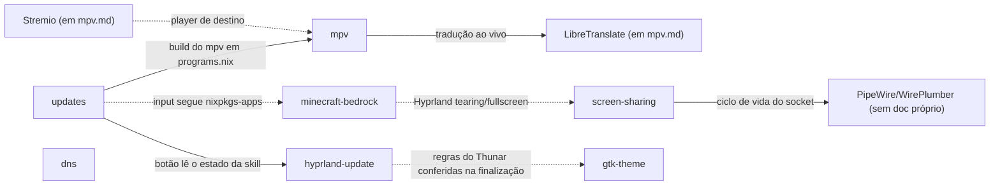

# Knowledge Docs — Índice

Grafo de conhecimento sobre subsistemas do repositório, para uso da IA.
Ver `.agents/rules/knowledge-docs.md` para quando/como manter isto.

Cada doc mapeia um subsistema cross-file: o quê, por quê, quais arquivos
fazem parte dele e como se liga a outros subsistemas. Novos docs entram
aqui conforme forem sendo criados — não é necessário documentar tudo de
uma vez.

## Docs existentes

| Doc | Resumo | Arquivos-chave |
|---|---|---|
| [mpv](mpv.md) | Player de vídeo com interpolação de frames e tradução ao vivo de legendas | `modules/nixos/programs.nix`, `config/mpv/` |
| [screen-sharing](screen-sharing.md) | Portais Wayland (hyprland/gtk) + PipeWire para screen share; fix do bug "morre até reiniciar a máquina" | `modules/nixos/hyprland-system.nix`, `config/xdg-desktop-portal/hyprland-portals.conf` |
| [minecraft-bedrock](minecraft-bedrock.md) | Bedrock Store via WineGDK (BedrockOnLinux); vsync/XWayland e render distance | `modules/nixos/minecraft-bedrock.nix`, `config/hypr/hyprland/windowrules/workspace-5-gaming.lua` |

| [updates](updates.md) | Grupos de atualização independentes (Hyprland, osu!, Sistema, Programas) e a Central de Updates | `flake.nix`, `modules/nixos/programs.nix`, `modules/nixos/update-groups.nix`, `tools/updates/` |
| [dns](dns.md) | Unbound local: cache, DNSSEC, DoT e bloqueio de anúncios com atualização semanal | `modules/nixos/local-dns.nix`, `config/hypr/hyprland/scripts/update-blocklist.sh`, `config/unbound/allowlist.txt` |
| [hyprland-update](hyprland-update.md) | Fluxo de update do Hyprland: skill `/update-hyprland` (baixa wiki/código, analisa, adequa) + trava no botão da Central | `.claude/skills/update-hyprland/SKILL.md`, `tools/updates/hyprland-update.sh`, `tools/updates/update-group.sh` |
| [gtk-theme](gtk-theme.md) | Tema GTK e ícones via dconf, paleta escura quente (adw-gtk3 + cores nomeadas) e as windowrules do Thunar | `modules/home/gtk-theme.nix`, `config/gtk-3.0/gtk.css`, `config/hypr/hyprland/windowrules/floating.lua` |

## Grafo de relações

Aresta sólida = link forte (dependência real, quebra se o outro lado sumir).
Aresta tracejada = link fraco (relação incidental/cosmética).

*Nota:* `LibreTranslate`, `Stremio` e `PipeWire/WirePlumber` ainda não têm
doc próprio — estão documentados como seções dentro de outros docs. Se
crescerem em complexidade própria (mais scripts, mais integrações),
promova-os a docs separados e atualize este grafo.

## Convenções

- Nome do doc = nome do subsistema, em minúsculas (`mpv.md`, `voice-normalizer.md`).
- Um subsistema, um doc. Se um doc passar de ~150 linhas, considere dividir.
- Ao adicionar um doc novo: acrescente uma linha na tabela acima e um nó no
  grafo mermaid, com a força do link para os docs relacionados.
